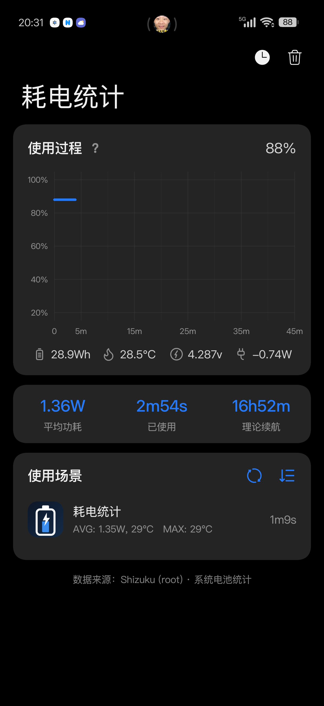
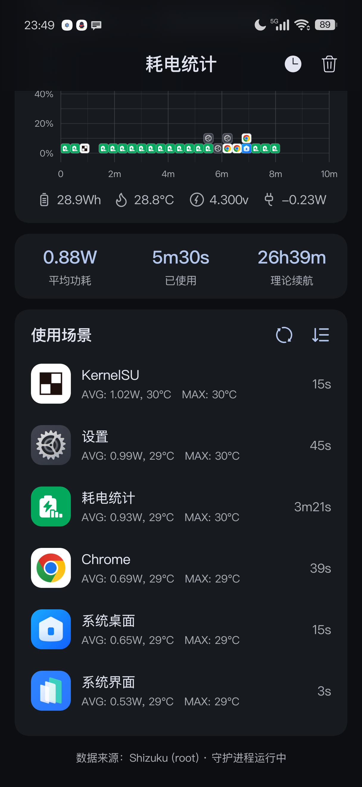
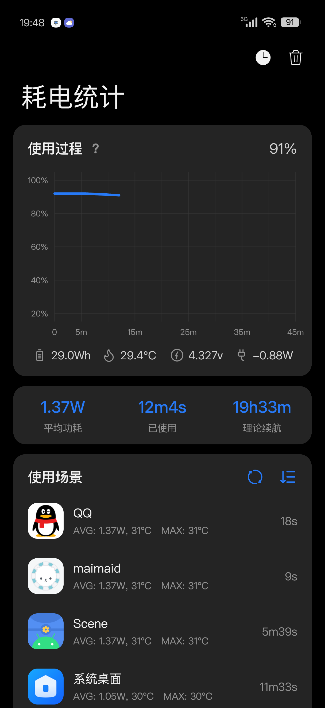
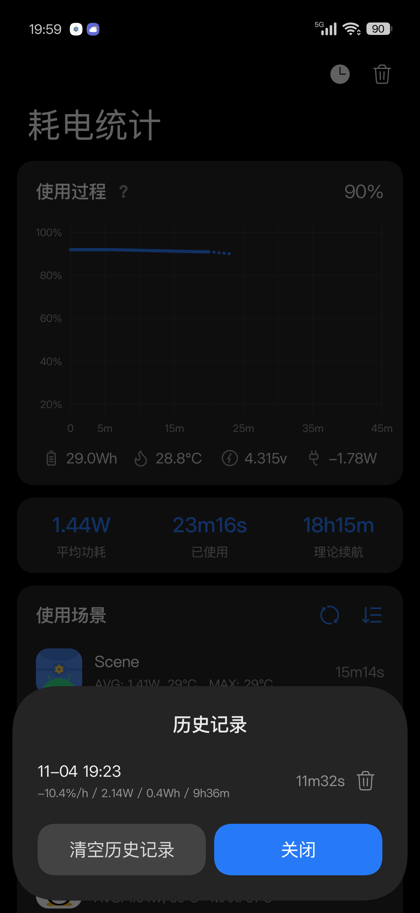

# 耗电统计 · Battery Monitor

把 Scene 的「耗电统计」页面单独拆出来做成的独立 App，界面用 **Jetpack Compose + [Miuix](https://github.com/compose-miuix-ui/miuix)**（HyperOS 风格设计系统）重新实现。

参考设计里底部的「在寻找其它功能吗?」一栏按需求**不做**。

| 主界面 | 折叠标题 | 说明提示 | 历史记录 |
| :---: | :---: | :---: | :---: |
|  |  |  |  |

## 功能

| 区块 | 内容 |
| --- | --- |
| 使用过程 | 电量曲线：屏幕点亮（蓝色实线）/ 屏幕关闭（灰色实线）/ 未记录（蓝或灰虚线），左侧 0%–100% 刻度，底部时间轴按 Scene 的档位（10m/15m/30m/45m/…/24h）自动缩放 |
| 图表 app 图标 | 与 Scene 同款：时间按 32px 分列，列内自 0% 基线向上堆叠（每层 34px，32px 图标 + 圆角描边），瓦数越大越靠上；**点击图表隐藏/显示** |
| 遥测行 | 电池满容量（Wh，按健康度折算）· 温度（°C）· 电压（v）· 实时功率（放电 `-x.xxW` / 充电 `x.xxW`） |
| 统计行 | 平均功耗 · 已使用 · 理论续航 |
| 使用场景 | 全部应用（不截断）：前台时长、平均功耗、平均/最高温度；左键切换 W↔mA，右键切换功耗升/降序 |
| 顶栏 | 大标题随滚动折叠为小标题（无返回键）；历史记录、清除本次统计（删除键有二次确认） |
| 刷新 | 整页 Miuix PullToRefresh 下拉刷新统计（卡片内不再有刷新按钮） |
| 历史记录 | 每次清除统计会存档一条：`-x%/h / xW / xWh / xh`，可单条删除或清空 |
| 说明提示 | 图表虚线含义的说明弹窗（对齐参考图） |

## 数据来源与算法（对齐 Scene 9.4.18）

**只走 Shizuku / Sui**：启动即请求权限。Sui 以 root 运行时（`Shizuku.getUid() == 0`）优先读
`/sys/class/power_supply/`（`current_now` / `voltage_now` / `capacity` / `temp` / `charge_full`，
即 Scene 用的 sysfs 来源）；只有 shell 身份时退回 `dumpsys battery`；逐应用统计始终用
`dumpsys batterystats`。

| 项目 | 口径（与 Scene 一致） |
| --- | --- |
| 采样 | **只在「放电 + 亮屏」时**每 3 s 记一条；充电/满电不记；熄屏补一个标记点后停止 |
| 平均功耗 | `avg(current × voltage)`（mW→W），只统计本会话亮屏放电样本 |
| 已使用 | `样本数 × 3 s` |
| 理论续航 | `剩余 Wh ÷ 平均功耗 × 0.9`（**按要求用剩余能量**，保留 Scene 的 0.9 折损） |
| 满容量 Wh | `charge_full(mAh) × 3.86 V`（≤2510 mAh 时 ×2 处理双电芯）——本机 7500 × 3.86 = **28.9 Wh** |
| 使用场景 | 同一批样本按包分组：`avg(current×voltage)`、`avg/min/max(温度)`、时长 `样本数×3 s`；不经整机平均兜底，没有样本的包不出现 |
| 曲线 | 相邻样本间隔 **> 10 s** 判为未记录（虚线）；`包名/充电/电量/亮屏`任一变化即切段 |
| 会话重置 | 间隔 > 24 h、间隔 > 30 s 且电量上升、`|I| > 60 A` |

> **电流单位自校准**：这台 OPPO 的 `current_now`（0.1 mA 量级）与 `dumpsys` 的 `Battery current`
> （mA 量级）都不是标准 µA，所以每次读数都按 µA/mA/0.1 mA 三种解释算功率，再与充电计数器的
> ΔWh/Δt（≥5 s 窗口）比对，取比值 0.33–3 内最接近的那个；超界读数直接丢弃，不夹逼、不入库。

界面底部显示 `数据来源：Shizuku (root) · 系统电池统计` 或 `Shizuku (shell)`。

> 本机实测（OnePlus PLZ110 / Android 17 / 7500 mAh）：root 模式下瞬时功率 −0.74 W、
> 平均功耗 1.36 W、理论续航 16h52m、哔哩哔哩逐应用 2.55 W —— 与 Scene 同量级（其对照片 2.03 W / 2.69 W）。

## 权限

- **Shizuku / Sui**：必需。安装并激活 Shizuku（或使用 Sui 这类 root 模块）后，应用启动会自动弹出授权请求。
- **root（可选）**：在 Sui 里给本应用 root 权限后，瞬时功率/电压走 sysfs，跟上屏幕负载变化；
  只有 shell 权限时用充电计数器估算（≥5 s 窗口，粒度 1 mAh），数值更保守。

## 构建

版本号：`versionName` 固定 `1.0`，`versionCode` 用 **git commit 数**，不用手改：

| 字段 | 取值 |
| --- | --- |
| `versionName` | 固定 `1.0` |
| `versionCode` | `git rev-list --count HEAD`（每次提交 +1，`adb install -r` 直接覆盖升级） |

`versionCode` 可用 `-PversionCode=123`（或环境变量 `VERSION_CODE`）临时覆盖；
不在 git 仓库里（比如源码压缩包）时回落到 `1`。

```bash
./gradlew -q :app:printVersion      # 看当前推导出的版本，例如 versionCode=4 / versionName=1.0
./gradlew :app:assembleRelease
# 产物：app/build/outputs/apk/release/app-release.apk

adb install -r app/build/outputs/apk/release/app-release.apk
```

- **只打 arm64-v8a**（`ndk.abiFilters`），单 APK 约 8 MB。
- release 用 **debug 签名**（`signingConfig = signingConfigs.getByName("debug")`），只为侧载，不上架。

环境：JDK 17+（本机 Gradle 9.6 / JDK 25 可直接构建），Android SDK 37，minSdk 29。

## CI（GitHub Actions）

`.github/workflows/android.yml`：push 到 `main`、PR、手动触发都会构建一个 release APK（arm64-v8a、debug 签名），
版本号规则与本地一致，产物按 `BatteryMonitor-1.0-build<commit 数>-arm64-v8a.apk` 上传到 Actions Artifacts；
打 `v*` tag 时还会附到 GitHub Release。构建前会校验 APK 的 `versionCode`、ABI 和签名。

- `checkout` 必须 `fetch-depth: 0`，浅克隆算出来的 commit 数是 1。
- workflow 缓存 `~/.android/debug.keystore`，让不同次 CI 构建的签名保持一致、可以互相覆盖安装；
  它和本机 debug 签名的包互不兼容，跨来源安装要先卸载。

## 技术栈

- Kotlin，AGP 9 内置 Kotlin 支持（无需单独应用 Kotlin 插件）
- Compose BOM `2026.09.00`
- Miuix `0.9.4`（`miuix-ui` + `miuix-icons`）
- Shizuku API `13.1.5`（`api` + `provider`）
- 状态：`StateFlow` + `AndroidViewModel`，无第三方 DI / 数据库依赖

## 结构

```
app/src/main/java/dev/shiko/batterymonitor/
├── MainActivity.kt              # 入口，权限跳转
├── PowerStatsViewModel.kt       # 仅做生命周期桥接
├── model/Models.kt              # BatterySnapshot / ChartSample / UsageScenario / PowerUiState …
├── data/
│   ├── PowerStatsRepository.kt  # 聚合状态，两条数据通道的统一出口
│   ├── BatterySampler.kt        # 广播 + 定时采样
│   ├── UsageStatsProvider.kt    # UsageStatsManager + 图标/标签
│   ├── ShizukuBridge.kt         # Shizuku 服务检测、授权、exec
│   ├── SystemBatteryStatsSource.kt # dumpsys battery / batterystats 解析
│   ├── PowerMath.kt             # 功耗、续航、平滑等纯计算
│   └── SessionStore.kt          # SharedPreferences 持久化
├── ui/
│   ├── PowerStatsScreen.kt      # Scaffold + 折叠顶栏 + 卡片编排
│   ├── theme/Theme.kt           # MiuixTheme 明暗配色
│   └── component/
│       ├── UsageProcessCard.kt  # 使用过程卡片
│       ├── UsageChart.kt        # Canvas 曲线
│       ├── TelemetryIcons.kt    # 手绘电池/温度/电压/插头图标
│       ├── ChartLegendDialog.kt # 说明提示弹窗
│       ├── StatSummaryCard.kt   # 平均功耗/已使用/理论续航
│       ├── UsageScenarioCard.kt # 使用场景列表
│       └── SessionHistoryDialog.kt
└── util/Format.kt               # 时长/功率/温度/电压格式化
```

## 与参考图的差异

- 顶栏改为可折叠大标题（按需求），并去掉返回按钮。
- 配色使用 Miuix 的 token（卡片 `surfaceContainer` #242424，页面 `surface` 纯黑），与参考图的 #0A0A0A 卡片略有不同。
- 字号整体比参考图大约 1–2sp。
- 遥测图标为本项目手绘的矢量图（参考图的图形在 Miuix 图标集中不存在）。
